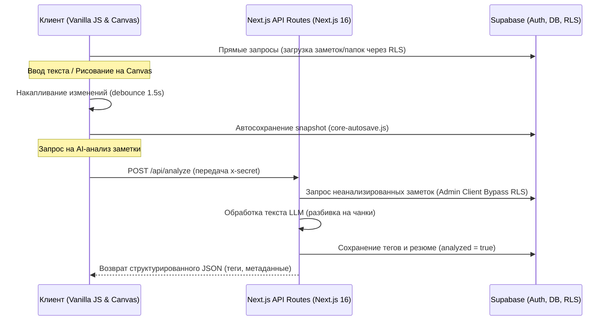

# SmartNotes

SmartNotes — это полнофункциональное веб-приложение для создания, хранения и организации заметок, которое предлагает мощный редактор текста с поддержкой слоев рисования, совместного доступа и продвинутой обработки контента с помощью искусственного интеллекта. Проект использует гибридную архитектуру, где сервер работает на базе Next.js и Supabase, а клиентский интерфейс построен на кастомном Vanilla JS движке для достижения максимальной производительности.

## Обзор проекта

SmartNotes создано для пользователей, которым требуется больше, чем просто блокнот. Будь то математические вычисления прямо в тексте, рисование поверх текста или автоматический анализ текста нейросетью — всё работает в одном пространстве.

### Ключевые возможности:
- **Организация пространства:** Создание папок, многостраничных заметок, система архивации и скрытых тегов.
- **Мощный текстовый редактор:** Собственный движок редактора (Vanilla JS) с поддержкой форматирования, списков, вставки медиафайлов и калькуляции математических выражений "на лету".
- **Слой рисования (Canvas):** Возможность рисовать (перо, маркер, ластик) поверх заметок. Сохранение истории (undo/redo).
- **Совместная работа:** Общий доступ к заметкам и папкам с разделением ролей (`viewer` / `editor`).
- **AI-Ассистент:** Интеграция с различными LLM провайдерами (ChatGPT, Yandex, Claude, Ollama и др.) для классификации заметок и автоматической генерации метаданных. Подробнее в [AI Интеграция](docs/ai-engine.md).
- **Кастомизация (Темизация):** Продвинутая настройка тем интерфейса через CSS-переменные (цвета, прозрачность, шрифты, фоны).
- **Надежность:** Offline-режим с использованием Service Workers, централизованная генерация CSP.

## Технологический стек

- **Backend:** Next.js 16 (App Router), Node.js API Routes.
- **База Данных & Auth:** Supabase (PostgreSQL, Row Level Security, Supabase Auth).
- **Frontend (UI & Editor):** Кастомный Vanilla JS (ES Modules), Tailwind CSS (в рамках `postcss` для системных стилей, основная темизация в `base.css`).
- **Тестирование:** Встроенный Node.js Test Runner, JSDOM для UI, скрипты проверок модулей.

## Установка и запуск

Для локального запуска необходимо настроить переменные окружения и запустить Next.js.

1. **Клонируйте репозиторий и установите зависимости:**
   ```bash
   npm install
   ```

2. **Настройте переменные окружения:**
   Скопируйте пример файла конфигурации или создайте `.env.local` на основе документации (или если присутствует `env_example.md`).
   Обязательные ключи (пример):
   - `NEXT_PUBLIC_SUPABASE_URL`
   - `NEXT_PUBLIC_SUPABASE_ANON_KEY`
   - `SUPABASE_SERVICE_ROLE_KEY`
   - Ключи для AI (например, `OPENAI_API_KEY`, `API_SECRET`)

3. **Запустите режим разработки:**
   ```bash
   npm run dev
   ```
   Приложение будет доступно по адресу `http://localhost:3000`.

## Документация и архитектура

Подробное описание отдельных компонентов системы доступно в следующих статьях:

*   **[Архитектура системы (docs/architecture.md)](docs/architecture.md)** — Описание работы бэкенда (Next.js/Supabase) и кастомного клиентского Vanilla JS движка.
*   **[Интеграция ИИ (docs/ai-engine.md)](docs/ai-engine.md)** — Описание работы API аналитики, поддерживаемые LLM провайдеры и процесс мемоизации токенов.
*   **[Редактор и интерфейс (docs/editor-and-ui.md)](docs/editor-and-ui.md)** — Детали кастомного Rich Text Editor, слоя рисования Canvas API и Zero JS темизации.
*   **[Планы развития (docs/roadmap.md)](docs/roadmap.md)** — Дальнейшие шаги по интеграции векторного поиска, real-time коллаборации и оптимизации.

---

### 🛠️ Последние улучшения стабильности (Релиз-инфо)

Перед финальной сдачей и защитой проекта были полностью исправлены критические архитектурные проблемы синхронизации и UX:

1.  **Устранение Race Conditions в автосохранении:**
    *   В утилиты `Utils.debounce` добавлена поддержка метода `.cancel()`.
    *   При закрытии или быстром переключении заметок в `core-api.js` все запланированные таймеры сохранения и нормализации принудительно отменяются, предотвращая перезапись данных другой заметки.
2.  **Синхронизация Canvas при переключении страниц:**
    *   Внедрена система уникальных маркеров загрузки (`state.loadToken`) в `drawing-engine.js`.
    *   При переходе между страницами или быстрой смене заметок рендеринг холста проверяет токен. Если токен сменился за время анимации/загрузки, рендеринг отменяется, что исключает наложение старых рисунков на новые страницы.
3.  **Защита от зацикливания MutationObserver:**
    *   Выравнивание параметров обзервера в `renderState` и `bind` исключает бесконечные циклы перерисовки DOM при вставке некорректно отформатированного внешнего HTML.
4.  **Предотвращение потери данных в Offline-режиме:**
    *   Обновлен `SessionService` и обработчик синхронизации в `load-app.js`.
    *   При обрыве связи и последующем восстановлении сети, если токен сессии Supabase истек (JWT Expired), приложение больше не "молчит", а корректно отображает уведомление об истечении сессии и перенаправляет пользователя на страницу входа для безопасного сохранения несохраненного офлайн-стейта.

---

### 🔍 Схема потока данных (Data Flow)

Ниже представлена схема движения данных между клиентом, сервером Next.js и Supabase:



---

### 🏃 Запуск проверочных скриптов

В проекте настроены автоматические утилиты для проверки кодовой базы, расположенные в папке `scripts/`. Вы можете запускать их для валидации целостности:

*   **Проверка несвязанных модулей:**
    ```bash
    node scripts/check-unconnected-modules.mjs
    ```
    Используется для поиска "мертвых" ES-модулей, не подключенных к основному UI.
*   **Проверка неиспользуемых экспортов:**
    ```bash
    node scripts/check-unused-exports.mjs
    ```
    Выявляет функции и константы, которые экспортируются, но не импортируются другими модулями.
*   **Проверка границ доменов (Domain Boundaries):**
    ```bash
    node scripts/check-domain-boundaries.mjs
    ```
    Контролирует, чтобы модули редактора не импортировали напрямую логику UI-компонентов в обход `EventBus`.

